<picture>
  <source media="(prefers-color-scheme: dark)" srcset="assets/card-dark.svg">
  <source media="(prefers-color-scheme: light)" srcset="assets/card-light.svg">
  
</picture>

## 🛠️ What I'm building

<table>
  <tr>
    <td width="50%" valign="top">
      <a href="https://github.com/niklan1110/keel">
        <picture>
          <source media="(prefers-color-scheme: dark)" srcset="https://raw.githubusercontent.com/niklan1110/keel/HEAD/.github/assets/banner-dark.svg">
          
        </picture>
      </a>
      <h3><a href="https://github.com/niklan1110/keel">Keel</a></h3>
      A self-hosted backend that speaks Supabase: Postgres with an instant REST API, auth, storage, realtime, edge functions and a dashboard, on a machine you own.
        
      
      
      
      
    </td>
    <td width="50%" valign="top">
      <a href="https://github.com/niklan1110/agentic-office">
        <picture>
          <source media="(prefers-color-scheme: dark)" srcset="https://raw.githubusercontent.com/niklan1110/agentic-office/HEAD/docs/media/banner-dark.svg">
          
        </picture>
      </a>
      <h3><a href="https://github.com/niklan1110/agentic-office">Agent Office</a></h3>
      Build a team of Claude Code agents from skills, launch it into your project, and watch who is thinking, typing and talking in a live 3D office.
        
      
      
      
      
    </td>
  </tr>
</table>

## 🧰 Toolbox

  

## 📈 Activity

  <picture>
    <source media="(prefers-color-scheme: dark)" srcset="https://streak-stats.demolab.com?user=niklan1110&theme=github-dark-blue&hide_border=true&background=0D1117">
    
  </picture>

  <picture>
    <source media="(prefers-color-scheme: dark)" srcset="https://raw.githubusercontent.com/niklan1110/niklan1110/output/snake-dark.svg">
    
  </picture>

  

